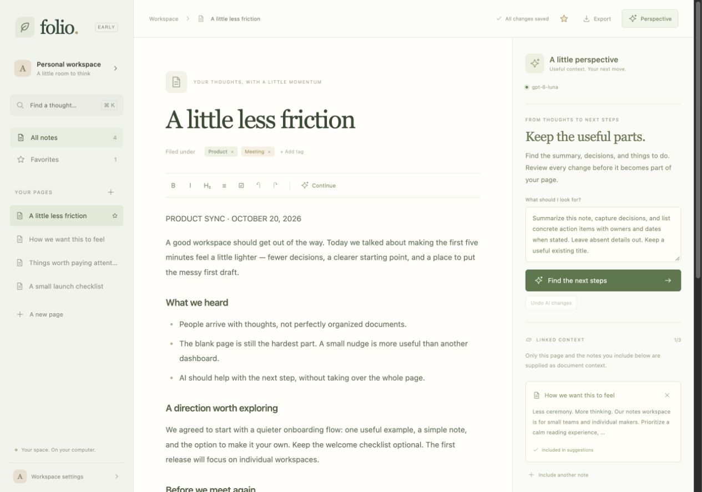
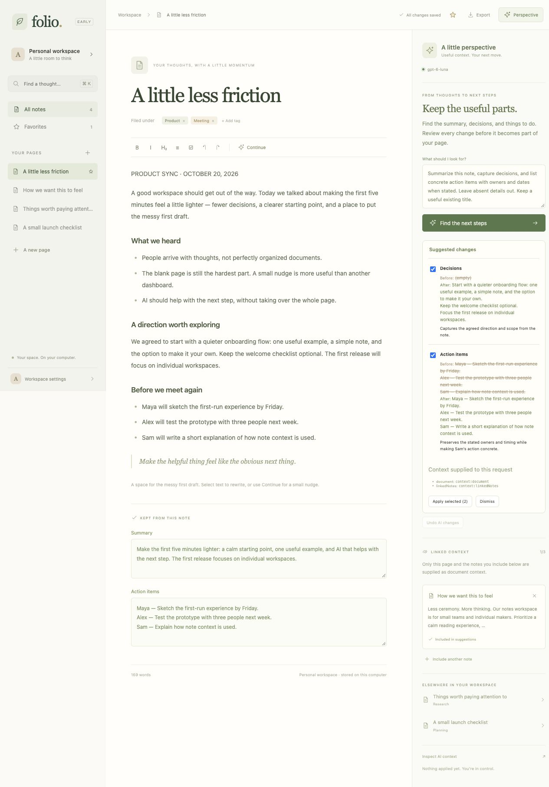
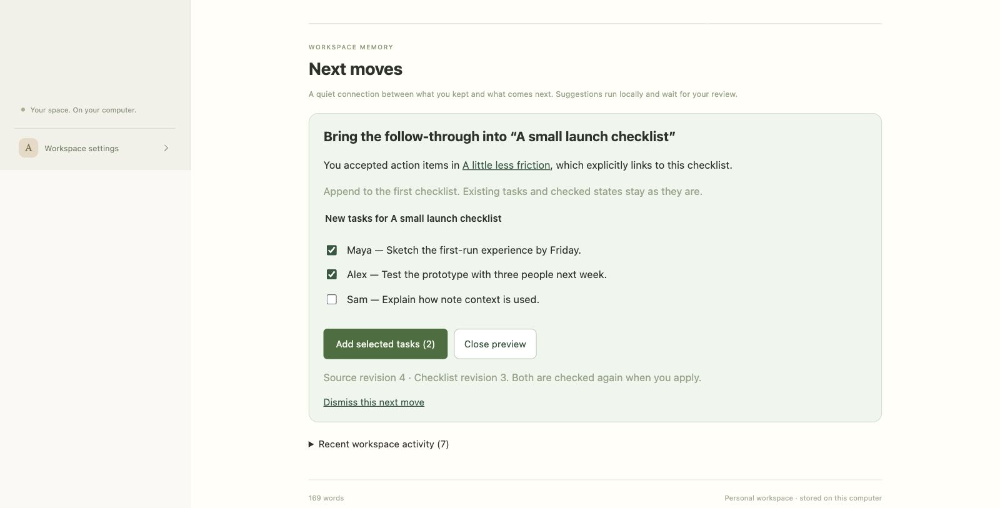
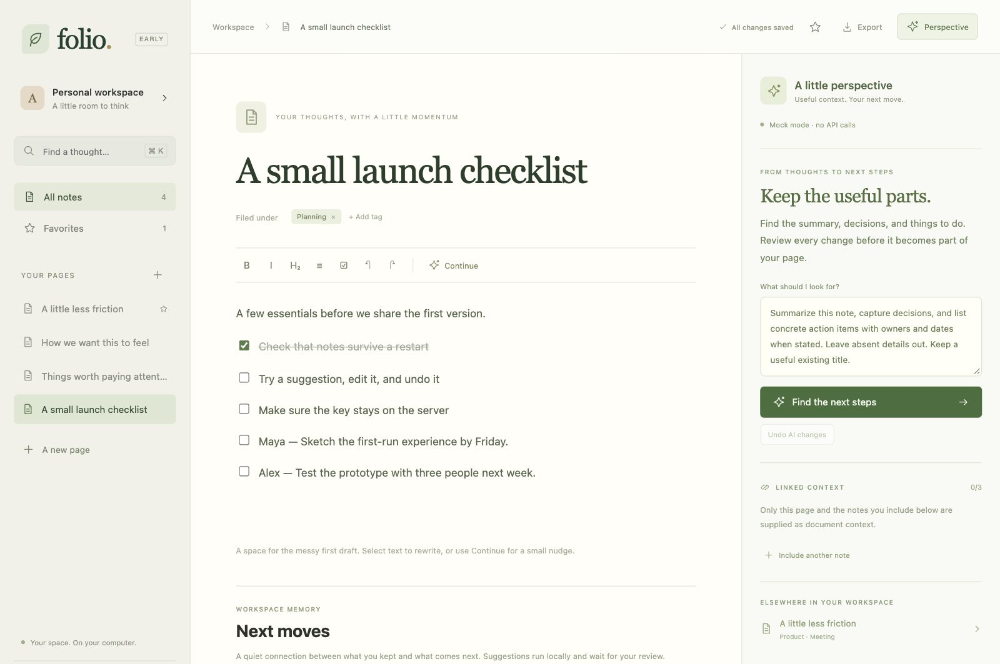
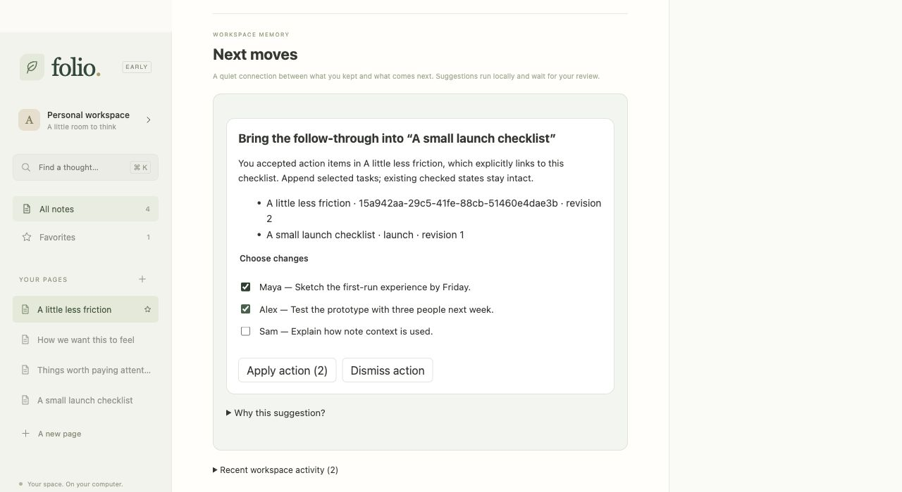
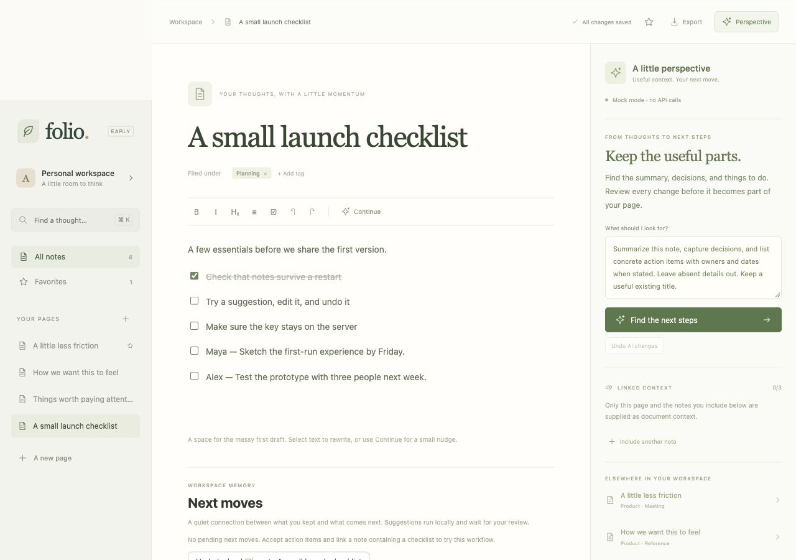

# Folio

A small, local notes workspace built around ordinary writing and reviewable AI assistance.
Built with React, TypeScript, Tiptap, and the packaged [AI Components library](https://github.com/AndrewTaoWen/AI-Components).

## Run

Requires Node 22.12+.

```sh
npm ci
npm run dev
```

Open [localhost:5190](http://127.0.0.1:5190). The first launch creates four sample notes.
**Mock mode is the default**, so you can try every review interaction without an API key.

## What works

- Rich-text notes: headings, bold, italic, bullet lists, checklists, blockquotes, and editor undo/redo.
- Create pages, edit titles, add/remove tags, favorite pages, and search note text locally.
- Automatic server-side saving, with atomic file replacement and revision checks to protect stale tabs.
- Select a passage to use `AIRewriteMenu`; review before replacing the selection. Editing invalidates stale drafts.
- **Continue** proposes a short suffix at the cursor. Click Insert or press Tab in the editor to accept it.
- **Perspective → Find the next steps** uses `useAISuggestion` and `AIChangePreview` to propose a title,
  summary, decisions, and action items. Select which fields to apply and undo the accepted batch.
- Accepted insights stay editable beneath the document; they are page properties, not automatically created tasks.
- Link up to three notes as explicit AI context. Inspect the selected context and recent accepted actions.
- **Next moves** connects accepted action items to an explicitly linked checklist, with selectable additions, persistent dismissals, and revision-guarded undo.
- Durable workspace activity records note changes, accepted/undone insights, and next move outcomes.
- Export a note and its insights to Markdown.
- Workspace settings control inherited writing instructions and mock/live mode.

### Try the main workflow

1. Open **A little less friction**, a sample product-sync note.
2. Open **Perspective** if the assistant is hidden on a smaller screen.
3. Inspect the linked product-principles note. Add or remove context as needed.
4. Click **Find the next steps**. The original document and page properties stay unchanged during review.
5. Uncheck Decisions and apply the remaining fields. Summary and action items appear below the editor.
6. Click **Undo AI changes** to restore the previous properties. Manually changing an affected field disables that undo.
7. Select text in the editor to reveal rewrite actions, or place the cursor after some text and click Continue.

Mock responses are deterministic examples, not model reasoning. Use live mode to test prompt engineering.

## GPT-6 Luna

```sh
cp .env.example .env.local
```

Set these server-only variables, then restart the development server:

```env
OPENAI_API_KEY=your-key-here
OPENAI_MODEL=gpt-6-luna
```

Open **Workspace settings** and switch AI mode to **Live**. The key remains on the server;
only its configured status and the model name are sent to the browser. `.env.local` is ignored by Git.
Live actions send the selected note context to OpenAI and incur API charges. The built-in adapter
uses the Responses API, strict JSON schemas for structured suggestions, reasoning effort `none`,
`store: false`, a 2,048-output-token cap, cancellation, and a 45-second timeout.

The current document is limited to its first 16,000 characters in recipe context. Up to three linked
notes contribute 2,000 characters each. Continue also uses up to 8,000 characters before the cursor.
The context inspector shows what was selected. Editing source text or linked context clears old proposals.
Prompt recipes now read the approved projection of persisted workspace events and latest accepted insights. This history is selected explicitly and is not automatically sent wholesale to the model.

## Try workspace memory

1. In **A little less friction**, include **A small launch checklist** under Perspective → Linked context.
   Fresh workspaces already include this link; existing workspaces keep their original links.
2. Use **Find the next steps**, accept the action items, and wait for **All changes saved**.
3. Below the accepted insights, open **Next moves → Review task additions**.
4. Select tasks and apply. The app appends them to the linked note’s first checklist as unchecked tasks.
   Existing tasks and their checked states stay intact. Open that note to inspect the result.
5. Use **Undo task additions** before making another edit to that checklist. A later edit disables undo.
6. Expand **Recent workspace activity** to inspect persisted actions. Refresh to re-read another tab’s
   activity. Dismissing a move suppresses that accepted batch for that target across restarts.

The first anticipation policy is deterministic and local: it copies accepted action-item lines and
removes duplicates by normalized text. It does not infer owners, deadlines, or arbitrary checklist
rewrites. It requires an explicit link and a task-list block. Manual edits to action items do not count
as AI acceptance. Review checks both source and target revisions; stale reviews fail without writing.
No model calls run in the background. For a disposable workspace, set `FOLIO_DATA_DIR` to a separate
directory before starting Vite (for example, `FOLIO_DATA_DIR=/tmp/folio-demo npm run dev`).

## Storage and current boundaries

Notes and workspace memory are stored together in **`.data/notes.json`**, outside Git, using one local server process. Keep a backup
of this directory. Version 1 files migrate atomically to version 2 without changing note revisions
or inventing past activity. History includes accepted action text and undo snapshots; treat the entire
data file as private workspace content. Events are retained for the workspace lifetime; retention and
compaction controls are future work. The last 100 mutation receipts make retries idempotent, including
a lost response after a successful write. Older stale retries fail safely on revision checks. Never run two app server processes against the same data directory. A note over
512 KB is rejected, leaving its open draft available to export. AI requests have a smaller 32 KB limit.

Conflicting saves return a visible error; they do not silently replace another tab's newer revision.
Export any unsaved draft before reloading a conflicting tab. Background save retries pause on an error
until you use Retry save. Editing, navigating between notes, and saving normal notes do not call a model.

This is a **single-user local MVP**, not a hosted Notion replacement. Accounts, permissions, real-time
collaboration, semantic/vector search, nested pages, persistent user preferences, file uploads, and
general agent planning and multi-note transactions are future work. Related notes use shared tags and explicit links;
search is literal text matching. AI extraction edits flat page properties; arbitrary block reordering
and arbitrary multi-page edits remain outside this version. The reviewed checklist addition is the
first cross-note workflow, with note mutation and its outcome event committed together.

Both `npm run dev` and `npm run preview` provide the local APIs. A static-only deployment does not.
The server accepts only localhost/same-origin requests; add authentication and deployment-specific
storage before hosting this for other people.

## Development

```sh
npm test
npm run build
npm run format:check
```

The component library is installed from `vendor/ai-components-react-045ec1b.tgz`, a built snapshot
of the shared-memory and change-preview stack. Its source is independent of this app, and no source
aliases or symlinks are needed. The tarball includes the library's MIT license.

- `src/editor.tsx`: Tiptap adapter, selection rewrites, cursor continuations.
- `src/note-page.tsx`: page properties, prompt recipe inputs, review UI, explicit linked context.
- `src/use-workspace.ts`: autosaving controlled note drafts without overwriting newer local edits.
- `src/workspace-memory.ts`: typed semantic intents, events, next moves, and commands.
- `src/next-moves.tsx`: task review, outcome controls, and durable activity UI.
- `server/anticipation.ts`: deterministic next move policy with explicit-link provenance.
- `server/store.ts`: atomic note/event persistence, migrations, idempotency, and revision checks.
- `server/openai.ts`: server-only OpenAI adapter.
- `server/notes-api.ts`: local note API.

Documentation: [Tiptap React](https://tiptap.dev/docs/editor/getting-started/install/react),
[OpenAI structured outputs](https://developers.openai.com/api/docs/guides/structured-outputs).

## Screenshots

The screenshots use the agent-authored sample notes. The review screenshot shows a live Luna response;
no user-provided private notes were included.





The workspace memory screenshots use an isolated sample workspace in mock mode.





## Shared framework migration

Folio now consumes the same packaged `useAIAction`, `AIActionReview`, `AIContextInspector`,
`defineAIPolicy`, and `evaluateAIPolicies` APIs as the support workflow in the separate playground.
Its checklist policy lives in `src/workspace-policy.ts`; no note schema is hardcoded in the library.
The server projects approved facts and outcomes into an `AIMemorySnapshot`, and the client replaces
that projection atomically without changing provider identity. Prompt recipes can borrow persisted
accepted insights after reload. The **Why this suggestion?** inspector shows the selected action,
source revision, linked checklist tasks, and completed-candidate evidence; the writing inspector
shows only context selected for its recipe.

The domain ledger and mutation receipts remain in Folio's atomic server store. They are authoritative
for stale-review rejection, recovery, and persisted undo. Library memory is their context projection,
not a second competing database. Recent projected history is bounded, while the latest accepted
insight remains available as a scoped fact. No extra model calls or browser-stored API keys are added.




